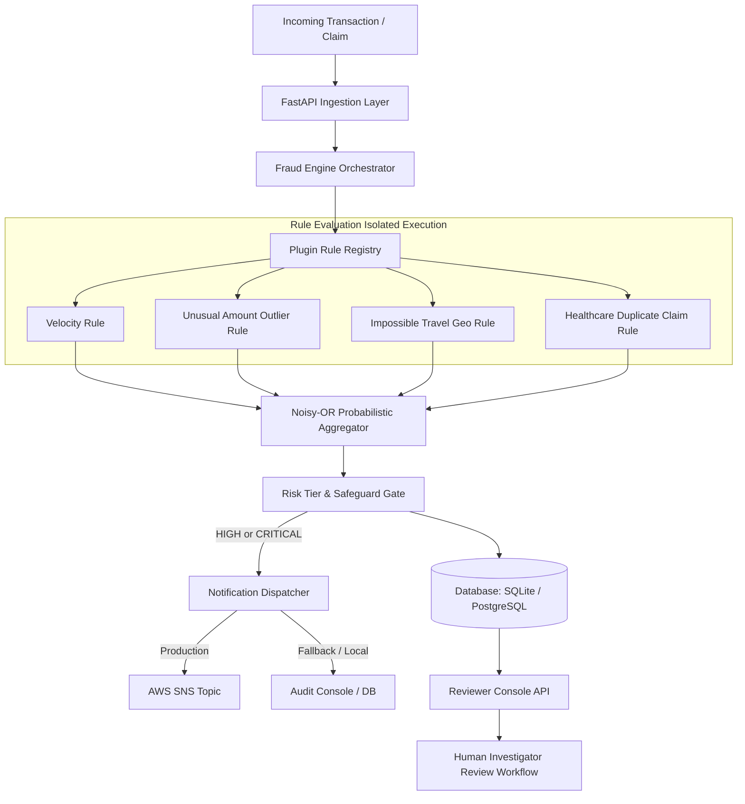

# VIGIL — Explainable Fraud Rule Engine with Review Console
**Acentra Health — BUILD TO CARE 2026 Codeathon**  
*Track: Advanced Fraud Detection & Healthcare Integrity*

[](https://www.python.org/)
[](https://fastapi.tiangolo.com)
[](https://www.sqlalchemy.org/)
[-brightgreen.svg)]()
[]()

---

## Executive Summary

**VIGIL** is an enterprise-grade, explainable fraud detection engine designed for healthcare claim processing and high-throughput financial transactions. Unlike opaque "black box" models, VIGIL delivers **transparent, auditable decisions** with rich mathematical evidence, probabilistic risk scoring, and a human-in-the-loop review console.

Built with an extensible **plugin-based architecture**, VIGIL allows rapid registration and auto-discovery of new fraud rules without modifying core engine logic.

---

## Key Architecture & Capabilities



### 1. Robust Probabilistic Risk Scoring (Noisy-OR Aggregator)
- **Mathematical Grounding**: Rules produce independent risk probabilities $p_i \in [0, 1]$.
- **Independent Combination**: Combined risk is calculated via the complementary probability of non-occurrence:
  $$P(\text{fraud}) = 1 - \prod_{i=1}^{n} (1 - w_i \cdot p_i)$$
- **Scale**: Normalized to an integer score between $0$ and $100$.
- **High-Tier Safeguard**: To prevent multiple weak, borderline signals from falsely escalating a transaction into `HIGH` or `CRITICAL`, VIGIL enforces that a transaction can only enter the `HIGH` tier if at least one rule independently produces an individual score $\ge 0.50$.
- **Risk Tiers**:
  - `LOW`: $0 - 29$
  - `MEDIUM`: $30 - 59$
  - `HIGH`: $60 - 84$
  - `CRITICAL`: $85 - 100$

### 2. Auto-Discovered Fraud Rules
Rules inherit from a base `Rule` class and are automatically discovered on startup from `app.rules` and `app.domains.*`:

1. **Velocity Rule (`velocity`)**:
   - Detects abnormal burst activity within sliding time windows (e.g., 5+ transactions in 5 minutes).
   - Linear interpolation between half-threshold and full threshold with configurable weights.
2. **Unusual Amount Rule (`unusual_amount`)**:
   - Uses **Median Absolute Deviation (MAD)** for statistical robustness against existing outliers:
     $$\text{Modified } Z\text{-Score} = \frac{0.6745 \cdot |x - \text{median}|}{\text{MAD}}$$
   - Smooth sigmoid-like score mapping between $Z_{\text{low}}$ and $Z_{\text{high}}$.
   - Cold-start fallback for accounts with insufficient transaction history.
3. **Geographic Anomaly / Impossible Travel (`geographic_anomaly`)**:
   - Computes great-circle distance using the **Haversine formula**.
   - Calculates implied travel speed ($v = \frac{\Delta d}{\Delta t}$) between consecutive transactions.
   - Flags physically impossible speeds ($>800\text{ km/h}$ warning, $>1500\text{ km/h}$ critical).
4. **Healthcare Domain: Duplicate Claim Rule (`duplicate_claim`)**:
   - Tailored for Acentra Health claim workflows.
   - Detects duplicate submissions for the same member, provider, and clinical procedure code within a configurable window (e.g., 7 days).
   - Escalates severity to `CRITICAL` when claim amounts are identical.

### 3. Explainability First
Every evaluation stores structured evidence alongside human-readable reasoning:
- Exact distance and elapsed minutes for impossible travel.
- Historic median, MAD, and modified z-score for outlier amounts.
- Duplicate transaction IDs and matching procedure categories for claim fraud.

### 4. Human-in-the-Loop Review Workflow & Optimistic Concurrency
- `FLAGGED` transactions can be transitioned to `REVIEWED` or `CLEARED`.
- **Optimistic Concurrency Control**: Each transaction maintains an integer `version`. Review requests must provide `expected_version`. If another reviewer modifies the transaction simultaneously, the API returns `409 Conflict`, preventing overwrites.
- **Full Audit Trail**: Every decision, timestamp, reviewer identity, and note is preserved in the `reviews` table and queryable via `GET /api/transactions/{txn_id}/reviews`.

### 5. Multi-Channel Alerting (AWS SNS + Fallback)
- Automatic alert dispatch on `HIGH` and `CRITICAL` risk tiers.
- Production integration with **AWS SNS** (`boto3`).
- Resilient local fallback to console and audit records if AWS credentials or network are absent.
- Alert deduplication prevents duplicate notifications for re-evaluations.

### 6. Deterministic Simulator
Includes 6 pre-configured synthetic scenarios:
- `normal`: Routine office visits and low-risk claims.
- `velocity_burst`: 8 transactions in 4 minutes.
- `huge_amount`: Baseline history followed by an $85,000 outlier claim.
- `impossible_travel`: New York to Tokyo within 15 minutes.
- `duplicate_claim`: Duplicate knee replacement surgery submissions.
- `multi_trigger`: Simultaneous velocity burst, extreme amount, and impossible travel.

---

## Directory Structure

```
vigil/
├── README.md                      # Project documentation
├── API_CONTRACTS.md               # Frontend integration guide & TypeScript types
├── config.yaml                    # Engine configuration & rule parameters
├── .env.example                   # Environment variable template
└── backend/
    ├── pyproject.toml             # Project metadata and dependencies
    ├── app/
    │   ├── main.py                # FastAPI entrypoint & app factory
    │   ├── static_console.py      # Developer verification console
    │   ├── simulator.py           # Deterministic scenario generator
    │   ├── api/
    │   │   └── routes.py          # REST API endpoints & route handlers
    │   ├── core/
    │   │   ├── config.py          # Pydantic configuration loader
    │   │   ├── context.py         # Evaluation history & state context
    │   │   ├── engine.py          # FraudEngine coordinator
    │   │   ├── models.py          # Domain models & Pydantic schemas
    │   │   ├── registry.py        # Rule discovery & plugin registry
    │   │   └── scoring.py         # Noisy-OR aggregator & risk tiering
    │   ├── database/
    │   │   └── database.py        # SQLAlchemy models (SQLite/PostgreSQL)
    │   ├── notify/
    │   │   ├── base.py            # Notifier interface
    │   │   ├── console.py         # Local console notifier & persistence
    │   │   └── sns.py             # AWS SNS publisher with fallback
    │   ├── rules/                 # Core fraud rules
    │   │   ├── base.py            # Abstract Rule class
    │   │   ├── amount.py          # Median Absolute Deviation outlier rule
    │   │   ├── geography.py       # Haversine impossible travel rule
    │   │   └── velocity.py        # Sliding window velocity rule
    │   └── domains/               # Domain-specific rule packages
    │       └── acentra_health/
    │           └── duplicate_claim.py # Healthcare duplicate claim rule
    └── tests/                     # Comprehensive test suite (88 tests)
        ├── conftest.py
        ├── test_amount.py
        ├── test_api.py
        ├── test_duplicate_claim.py
        ├── test_engine.py
        ├── test_geography.py
        ├── test_notifications.py
        ├── test_review.py
        ├── test_scoring.py
        └── test_velocity.py
```

---

## Quick Start Guide

### Prerequisites
- Python 3.11+
- Virtualenv or Conda

### 1. Installation & Environment Setup

```bash
cd backend

# Create and activate virtual environment (if not already created)
python3 -m venv venv
source venv/bin/activate

# Install dependencies
pip install -e .
```

### 2. Configure Environment (Optional)

```bash
cp ../.env.example .env
# Edit .env for custom database URL or AWS SNS Topic ARN
```

### 3. Run the Backend Server

```bash
source venv/bin/activate
uvicorn app.main:app --host 0.0.0.0 --port 8000 --reload
```

The server will start at:
- **Developer Verification Console**: [http://localhost:8000/](http://localhost:8000/)
- **Swagger OpenAPI Docs**: [http://localhost:8000/docs](http://localhost:8000/docs)
- **ReDoc Specification**: [http://localhost:8000/redoc](http://localhost:8000/redoc)
- **Health Check**: [http://localhost:8000/health](http://localhost:8000/health)

---

## Testing & Quality Assurance

VIGIL includes 88 unit and integration tests covering mathematical formulas, database interactions, optimistic concurrency, rule isolation, and notification handling.

```bash
source venv/bin/activate
cd backend
python -m pytest tests/ -v
```

### Test Suite Highlights
- **100% passing tests** (88/88 in < 1 second).
- **Rule Isolation**: Verified that an exception raised by a faulty rule never crashes other rules or the transaction evaluation.
- **Idempotency**: Submitting duplicate transaction IDs safely returns the existing assessment without duplicate records.
- **Concurrency**: Verified that mismatched version numbers trigger HTTP `409 Conflict`.
- **Pure Math Verification**: Known numerical tests for Haversine distances, MAD z-scores, and Noisy-OR combinations.

---

## API Summary Table

| Method | Endpoint | Description |
|---|---|---|
| `GET` | `/health` | Service health status |
| `GET` | `/` | Developer interactive verification console |
| `POST` | `/api/transactions` | Submit transaction/claim for fraud evaluation |
| `GET` | `/api/transactions` | Query transactions (supports status, tier, member, provider filters) |
| `GET` | `/api/transactions/{id}` | Retrieve transaction details & explanation breakdown |
| `GET` | `/api/transactions/{id}/risk` | Retrieve risk assessment & rule evidence |
| `PATCH` | `/api/transactions/{id}/review` | Transition status with version check (`REVIEWED`, `CLEARED`) |
| `GET` | `/api/transactions/{id}/reviews` | Retrieve review audit log history for transaction |
| `GET` | `/api/rules` | List registered rules, weights, and configurations |
| `GET` | `/api/alerts` | List dispatched alerts and channels |
| `GET` | `/api/dashboard/metrics` | Aggregate statistics for reviewer dashboard cards |
| `GET` | `/api/simulate/scenarios` | Catalog of available simulation scenarios |
| `POST` | `/api/simulate?scenario=...` | Execute deterministic demo scenario |
| `POST` | `/api/demo/seed` | One-click seed of all demo scenarios |
| `POST` | `/api/demo/reset?seed=true` | Reset database and optionally re-seed |

*For complete TypeScript definitions, payloads, and examples, refer to [API_CONTRACTS.md](file:///Users/shrutika/vigil/API_CONTRACTS.md).*